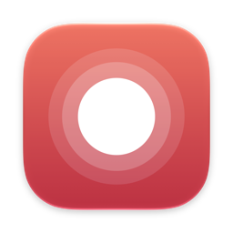
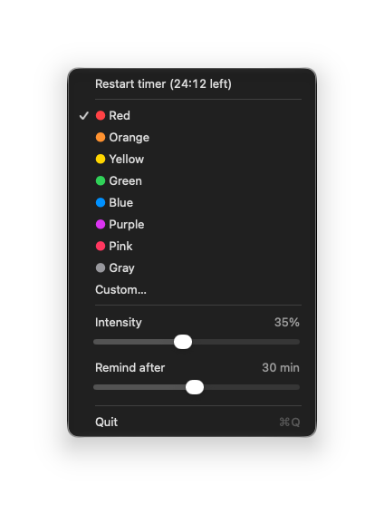

# Tint

A tiny macOS menu bar app that washes your screen in a color after a set time.
Click the menu bar icon to clear it and start the timer again.

There are no notifications, sounds or messages. When the color appears, it's time to get up.

## Usage

- **Left-click** the circle in the menu bar: clears the color and restarts the timer.
- **Right-click** (or Control-click) it to open the menu:



- **Restart timer** shows how long until the screen turns color, and restarts the timer when clicked.
- **Colors**: pick a preset or choose any color with **Custom…**.
- **Intensity**: how strongly the color covers the screen (5–75%). The tint shows while you drag, so you can see how strong it is.
- **Remind after**: 1–60 minutes (default 30).

The tint covers every display, including full-screen apps, and clicks pass through it. Settings are remembered.
The timer starts over when your Mac wakes from sleep.

## Build

Requires macOS 13+ on Apple Silicon and the Xcode command line tools (`xcode-select --install`).

```bash
./build.sh
```

This builds `Tint.app` and installs it to `~/Applications`. To start it automatically, add it under
System Settings → General → Login Items.
